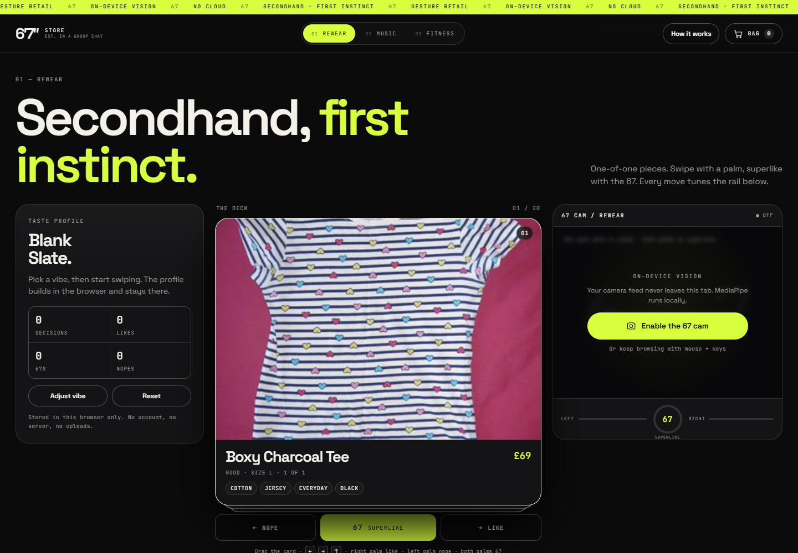
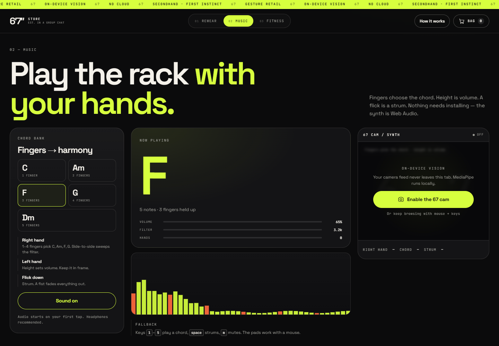
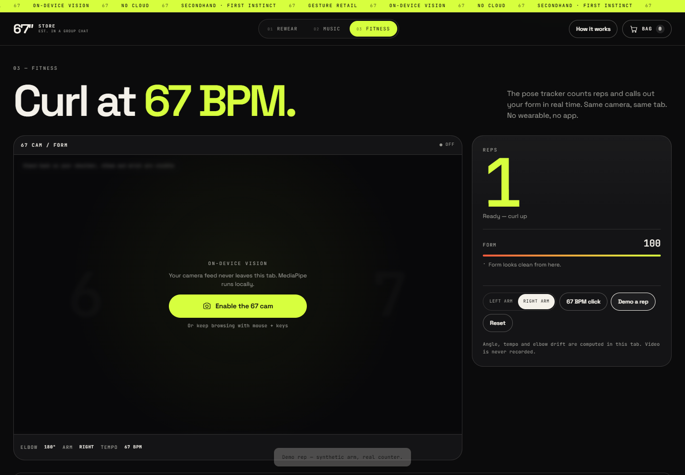

# 6′7″ Store — the browser implementation

A working, self-contained web build of the [`6′7″ store`](https://devpost.com/software/6-7-store) concept from HackNotts: gesture-driven resale, a hand-controlled synth, and a form-coached curl counter.

No Python. No native app. No backend. The whole thing is static files plus on-device computer vision and Web Audio — it runs in a tab and keeps working offline after the first load.



```bash
cd web
npm install
npm run dev        # http://localhost:5173
```

Camera access needs `localhost` or HTTPS. Chrome, Edge and Safari 17+ are the targets; without a camera everything still works with mouse, touch and keyboard.

---

## What is actually implemented

### 01 — Rewear (the store)

- A one-of-one secondhand rail built from the repo's clothing dataset (58 pieces across 10 categories), each with generated fit, colour, condition and size metadata.
- Dating-app deck: drag with a pointer, use `←` `→` `↑`, or use gestures.
  - **One open palm, right side of frame** → like (dwell ~0.6 s)
  - **One open palm, left side of frame** → nope
  - **Two open palms, rocking in opposite directions** → the 6…7 → superlike
- A taste profile that learns tag affinities from every yes/no/67, saturates so one obsession cannot take over, and re-ranks a “67 picks” rail with human-readable reasons.
- Onboarding “pick a vibe” seeds the profile; the profile, deck history and bag persist in `localStorage`.
- A browser-local bag + demo checkout with an order receipt. No payment, no shipping, no server.

| Music | Fitness |
| --- | --- |
|  |  |

### 02 — Music

- A Web Audio polysynth (detuned saw/triangle voices, lowpass filter, feedback delay) with five chords.
- **1–4 fingers** on the right hand pick `C`, `Am`, `F`, `G`; Dm is available on the pads.
- Left-hand height → volume; chord-hand position → filter cutoff; a downward/upward flick → strum; a fist → fade out.
- Live spectrum analyser, chord readout, hand overlay and clickable/keyboard fallback (`1`–`5`, `space`, `m`).
- A “kit” rail of instruments ranked by the same taste profile.

### 03 — Fitness

- Pose-based bicep curl counter: elbow angle, rep detection, live form notes (elbow drift, torso sway, depth, tempo) and a per-rep score log.
- **67 BPM** click track — the concept's joke made useful: keep each rep on the beat.
- “Demo a rep” synthesises an arm so the coaching UI can be reviewed without a camera.
- A gear rail ranked by taste.

### Shared

- One camera panel, two MediaPipe models (hand + pose), lazily loaded, GPU delegate with CPU fallback.
- Gesture maths is pure and unit-tested: `src/lib/gestures.ts`.
- Taste engine is pure and unit-tested: `src/lib/recommender.ts`.
- Responsive layout down to 390 px, keyboard operable, `prefers-reduced-motion` respected.
- Everything is local: no analytics, no uploads, no third-party runtime requests.

---

## How the 67 gesture is detected

`SixtySevenDetector` in `src/lib/gestures.ts`:

1. Requires two hands, both with at least three of the four long fingers extended.
2. Sorts them by screen x and requires a plausible horizontal separation and framing.
3. Tracks `leftWrist.y − rightWrist.y` over a rolling 1.5 s window.
4. Scores the peak-to-peak *anti-phase* range, counting direction reversals so a single sweep does not count.
5. Accepts a static two-palm hold (about 1.8 s) as an accessible fallback.
6. Fires above 0.72 with a cooldown + re-arm, so holding the pose cannot spam superlikes.

Single-palm likes use the mirrored display x position (right = like) plus a dwell bar, and are suppressed whenever two hands are present.

Fitness rep counting uses the interior elbow angle: a rep starts below 100°, must return above 150°, and is scored on depth, tempo and joint drift.

---

## Architecture

```
web/
  index.html                  static shell, header + footer
  src/
    main.ts                   app shell, routing, onboarding, help, orders
    fonts.css                 local @font-face rules (OFL fonts)
    styles.css                design system, layout, responsive rules
    data/
      catalog.ts              apparel + music + fitness catalog
      photos.json             generated photo manifest
    lib/
      gestures.ts             pure hand/67/raise/curl maths
      recommender.ts          taste profile, ranking, explanations
      vision.ts               camera + MediaPipe loaders + frame loop
      audio.ts                Web Audio synth, delay, metronome
      store.ts                localStorage state, cart, orders
    ui/
      stage.ts                the shared camera panel
      rewear.ts music.ts fitness.ts
      cart.ts modal.ts product.ts art.ts draw.ts dom.ts
  public/
    models/                   hand_landmarker.task, pose_landmarker_lite.task
    wasm/                     MediaPipe vision runtime
    products/                 sampled dataset photos
    fonts/                    woff2 files
  scripts/
    import-assets.mjs         pulls models, copies wasm, samples the dataset
    fetch-fonts.mjs           downloads the two OFL fonts locally
  tests/                      vitest suites for gestures + recommender
```

Why no LLM: the original relied on a local LLM to make recommendations. For a static web app, a transparent content-based recommender does the useful part — learning from swipes, staying diverse, and explaining itself — with no model download, no API key and no hallucinated product names. The “why” strings are generated from the actual learned weights, so the rail is auditable.

---

## Scripts

| Command | Does |
| --- | --- |
| `npm run dev` | Vite dev server |
| `npm run build` | Typecheck + production build into `dist/` |
| `npm run preview` | Serve the production build |
| `npm test` | Run the gesture + recommender test suites |
| `npm run import-assets` | Re-sample photos from the repo dataset, copy wasm, download models |
| `npm run deploy` | Build and deploy the static files with Wrangler |

## Deploy

`wrangler.jsonc` is an assets-only Worker config — no server code, no bindings:

```bash
cd web
npx wrangler login      # once
npm run deploy
```

Or use any static host: `npm run build` and publish `dist/`. Camera access requires HTTPS on real deployments (Cloudflare gives you that automatically).

## Controls

| Input | Where | Action |
| --- | --- | --- |
| Drag card / `←` / `→` / `↑` | Rewear | nope / like / 67 superlike |
| Right palm / left palm | Rewear cam | like / nope (dwell) |
| Two palms, alternating | Rewear cam | 67 superlike |
| `1`–`5` | Music | play chord |
| `space` / `m` | Music | strum / mute |
| `c` / `esc` | Global | bag / close |
| `Demo a rep` | Fitness | synthetic rep for review |

## Asset notes

- Hand and pose models: MediaPipe Tasks (`hand_landmarker`, `pose_landmarker_lite`), Apache-2.0, served from this site (not a CDN).
- Clothing photos: sampled from the original repo's `67Conductor/Server_src/static/dataset` folder.
- Fonts: Space Grotesk and JetBrains Mono, SIL Open Font License 1.1, stored in `public/fonts`.

## Known limits

- Detection quality depends on light and framing; the 67 needs both open hands inside the frame. Mouse/keyboard are first-class fallbacks.
- MediaPipe runs on WebAssembly/WebGL; very old devices may be slow or fall back to CPU.
- The checkout is intentionally fake; there is no payment, inventory or shipping backend.
- Taste and bag are per browser profile, not per account.
